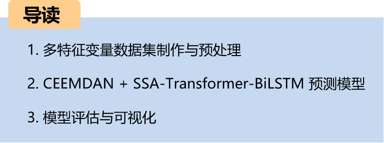
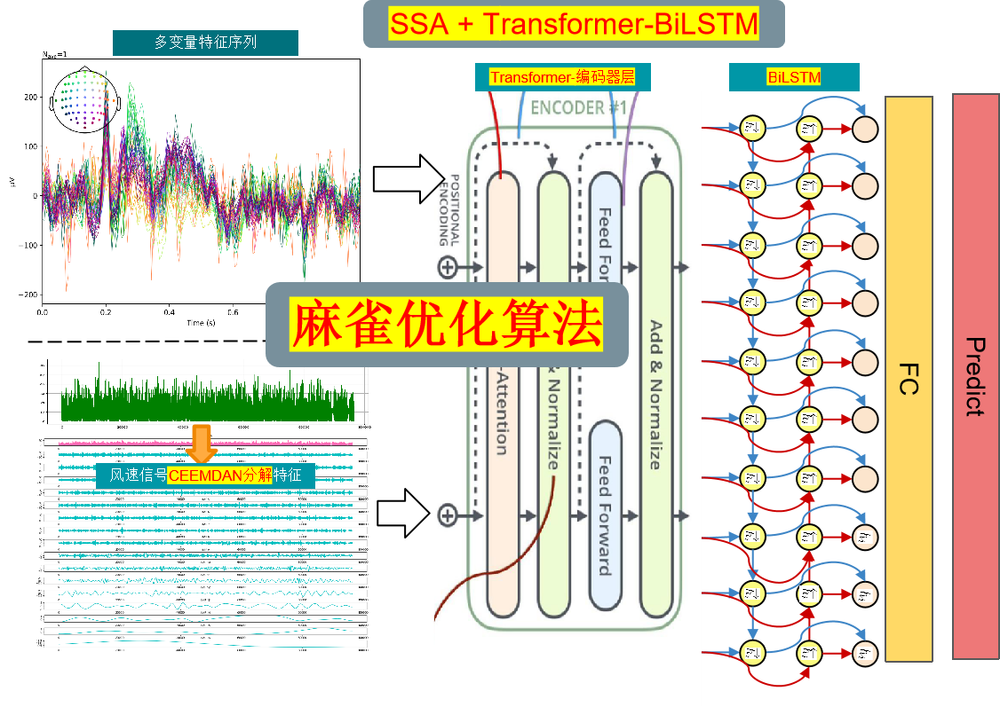
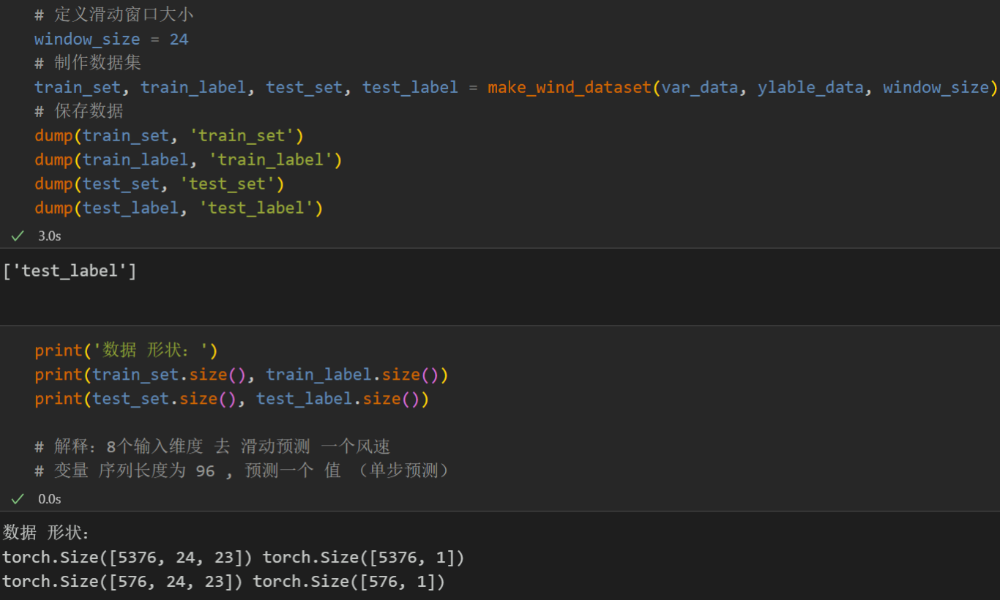
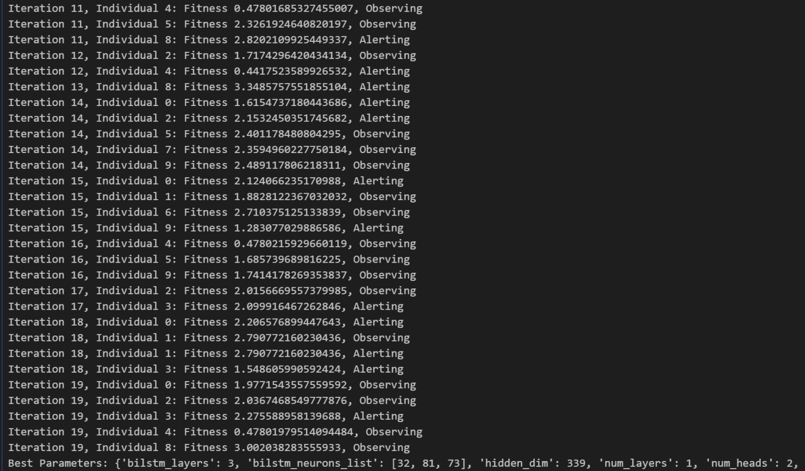
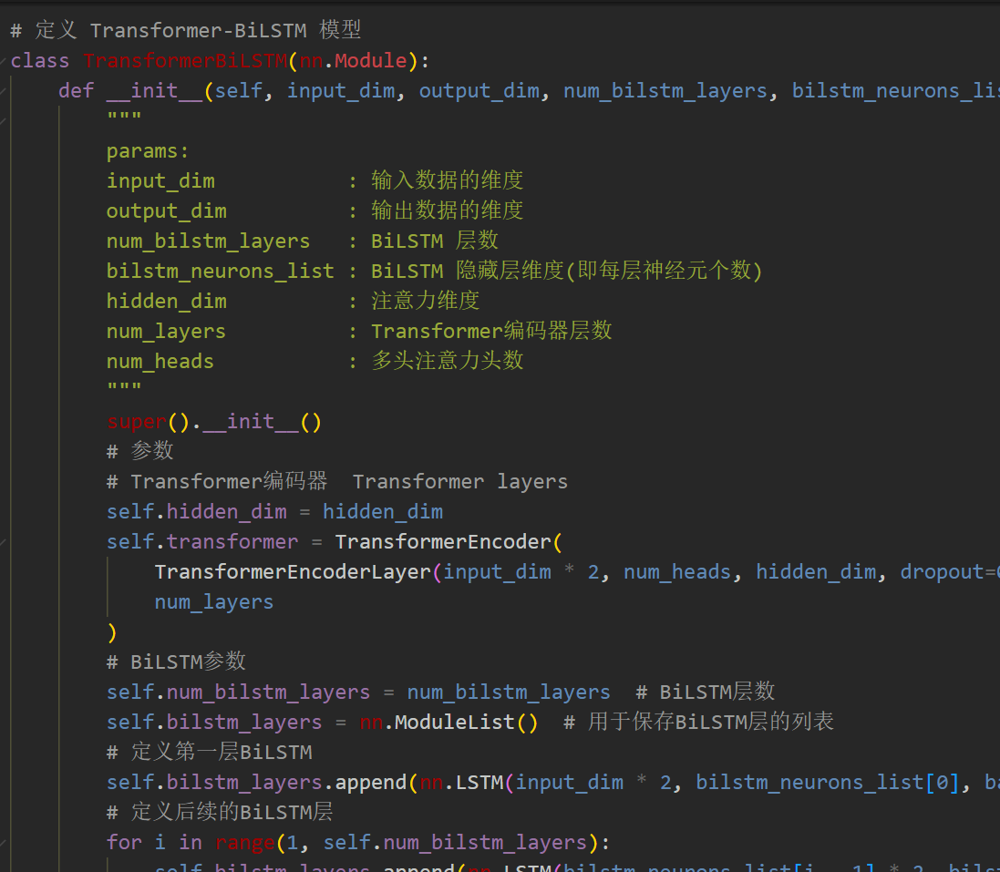
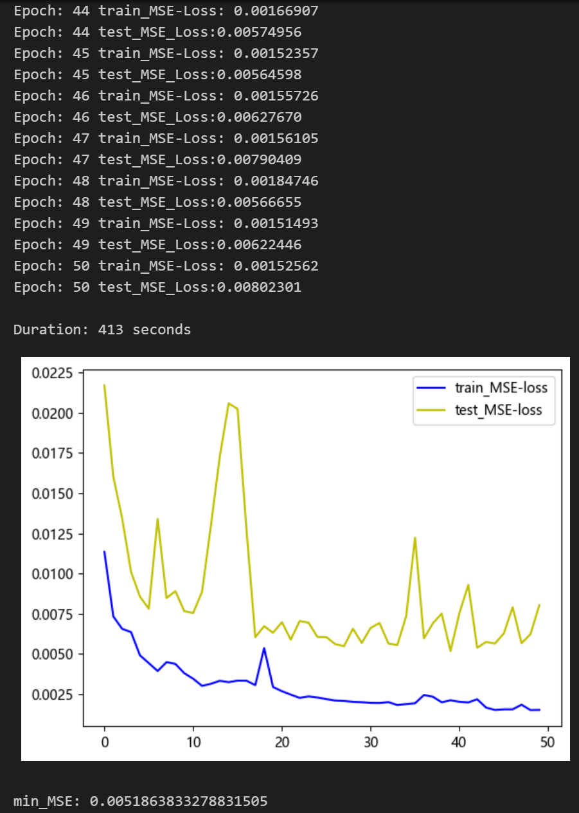
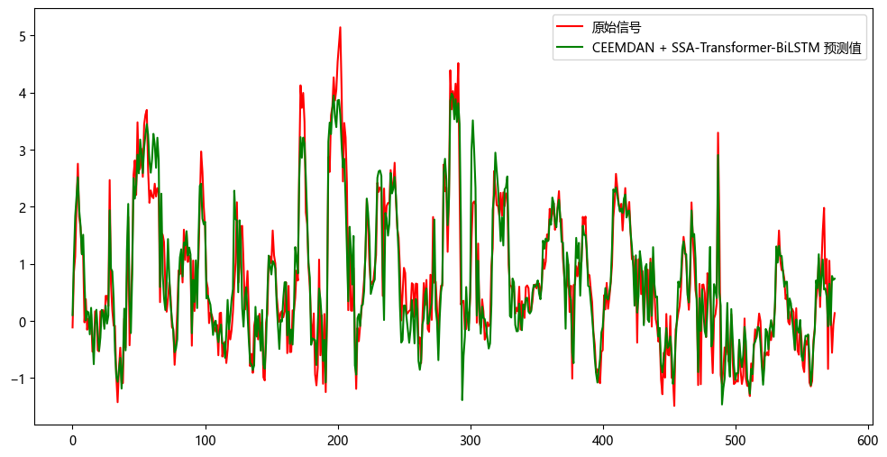
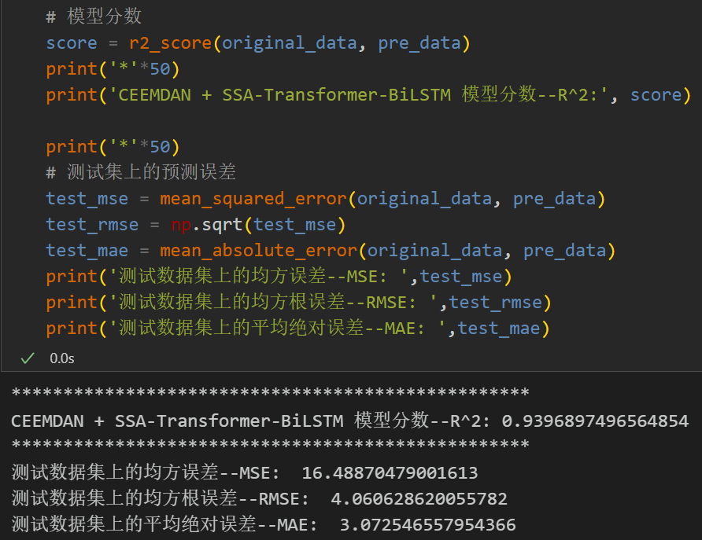
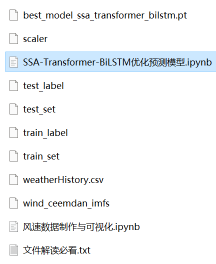

# Multi-feature Variable Sequence Prediction (10) CEEMDAN-SSA-Transformer-BiLSTM Prediction Model Based on Sparrow Optimization Algorithm

The text includes data preprocessing and CEEMDAN decomposition codes, as well as complete CEEMDAN+SSA-Transformer-BiLSTM model prediction and visualization code.
Preface:
This article introduces a comprehensive application of the CEEMDAN method with SSA-Transformer-BiLSTM multi-feature variable sequence prediction model based on the previously introduced wind speed data (data set attached at the end). The aim is to enhance the predictive performance of time series data.
Overall Model Structure:
The dataset consists of nine variables including weather, temperature, humidity, pressure, and wind speed. The CEEMDAN algorithm is used to decompose the wind speed sequence, then all components are combined with the original dataset variables to form an enhanced feature input. A sliding window is created for the dataset, and multiple variables are utilized for predicting wind speed. The SSA-Transformer-BiLSTM model is optimized using the Sparrow Optimization Algorithm to extract the enhanced features, which are then fed into the fully connected layer to achieve a high-precision prediction model.
1. Multi-Feature Variable Data Set Preparation and Preprocessing:
1.1 Import Data
1.2 CEEMDAN Decomposition
1.3 Data Set Preparation and Preprocessing:
Firstly, combine the original data variables and the decomposed components, dividing the training set and test set at a ratio of 9:1.
Data Set Production
2. Sparrow Optimization Algorithm:
2.1 Introduction to Sparrow Optimization Algorithm
Sparrow Optimization Algorithm (SOA) is an optimization algorithm based on the characteristics of bird behavior in nature. It simulates the optimization strategies of birds in foraging, migration, and social interactions. The SOA demonstrates good performance in solving various optimization problems.
The basic idea of the Sparrow Optimization Algorithm is to continuously optimize solutions in the search space by simulating the foraging behavior of birds. The process can be divided into three stages: foraging behavior, migration behavior, and social behavior.
1. Foraging Behavior: When searching for food, birds choose food sources that are closer and have higher fitness values. In the algorithm, each individual in the solution space is considered a food source with a fitness evaluation value. Birds select individuals with higher fitness values to find better solutions.
2. Migration Behavior: If birds do not find a better solution after searching around a food source for a certain period, they will choose to leave the current food source and move to other food sources to continue searching. In the algorithm, the position information between individuals will change to simulate the migration behavior of birds.
3. Social Behavior: When birds are foraging, they communicate with other birds to obtain more information and improve their foraging efficiency. In the algorithm, individuals exchange information to improve their solutions and update the optimal solution in the solution space.
\t2.2 Implementation of Sparrow Optimization Algorithm Based on Python
\t2.3 Superparameter Optimization Process of Sparrow Optimization Algorithm
The Sparrow Optimization Algorithm has the characteristics of simplicity, easy implementation, global optimization capability, and self-adaptability, making it suitable for solving combinatorial optimization problems. We use the Sparrow Optimization Algorithm to perform superparameter optimization for the SSA-Transformer-BiLSTM model.
By setting the appropriate population size and number of optimization iterations, we search for the optimal parameters within the given hyperparameters range.
3. Prediction Model Based on Pytorch's CEEMDAN + SSA-Transformer-BiLSTM
\t3.1 Define the prediction model based on CEEMDAN + SSA-Transformer-BiLSTM
\tNote: The input wind speed data shape is [64, 24, 23]. Batch size = 64, where 24 represents the sequence length (the sliding window takes values), and the dimension of 23 represents the dimensions of the selected 8 variables and 15 components.
\t  
\tWhen using the multi-head attention in the Transformer model, the input dimension must be divisible by num_heads (the number of attention heads). This is because in the multi-head attention mechanism, the input embedding vectors are divided into multiple heads, each head has a dimension of embed_dim / num_heads. Therefore, embed_dim must be divisible by num_heads to ensure that it can be evenly distributed to each attention head.
\tSince the input dimension is 23, this paper adopts a half-split stacking method to make the input shape [64, 12, 46].
\t3.2 Set parameters and train the model
\t50 epochs, MSE is 0.005186. The prediction effect of multi-variable features using CEEMDAN + SSA-Transformer-BiLSTM is good. After adding CEEMDAN decomposition, the prediction effect of multi-variables has been significantly improved, with excellent performance. By appropriately adjusting the model parameters, the prediction performance can be further improved.
\tNote: Adjust parameters:
\tYou can modify the population size of the bird optimization algorithm and the number of optimization iterations;
\tAdjust the parameter search range for the number of layers in the Transformer encoder, the number of multi-head attention heads, and the number of dimensions in the BiLSTM layer, increasing more epochs (be careful not to overfit)
\tChange the sliding window length (set a suitable window length)
4. Model Evaluation and Visualization
\t4.1 Results Visualization
\t4.2 Model Evaluation

## Images

<!-- PAYMENT_BLOCK -->

## Get this dataset

- Payment link (Stripe): [Buy now](https://buy.stripe.com/3cs8yP7sY87d0vu9AB)
- Payment QR code: 

<!-- /PAYMENT_BLOCK -->
